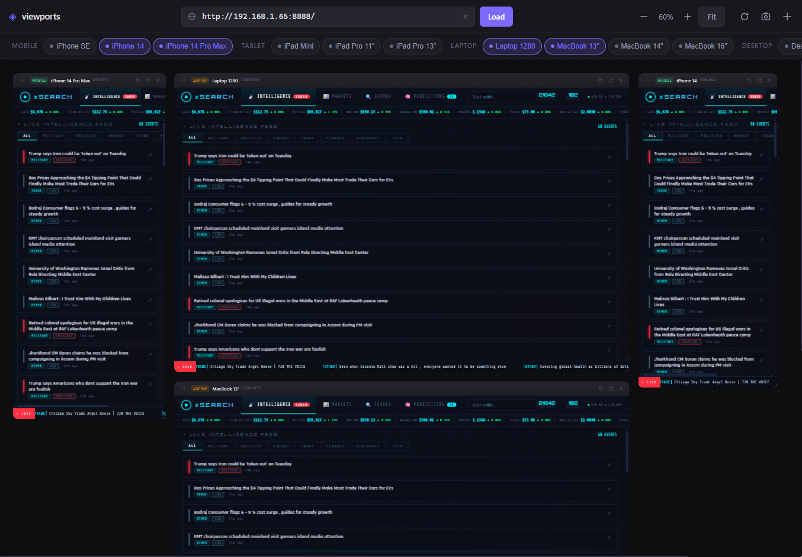

# ◈ viewports

> See your site at every screen size — simultaneously.

Open the same site in separate, live desktop windows at phone, tablet, and desktop sizes. Each window can move independently and keeps its preset viewport dimensions when scaled to fit the display.

Run with Node.js 22.12 or newer and a running dev server:

```bash
npx @kubilaycakmak/viewports http://localhost:3000
```

To run from a checkout:

```bash
git clone https://github.com/kubilaycakmak/viewports.git
cd viewports
npm ci
npm start -- http://localhost:3000
```

The first desktop launch downloads Electron. If the official download has a temporary network error, Viewports retries and then uses the mirror documented by Electron. The Electron installer verifies the archive against the checksums bundled with the npm package. Custom Electron mirror settings are respected.

In an interactive terminal, select devices, the top and bottom areas, and text size with the keyboard. iPhone 17, iPad Pro 11, and Desktop HD are preselected. The menu stays open so you can add or remove devices and change settings. Select **Exit menu** to leave the previews open.

Pass `--devices` to open selected presets directly. Resize a window by dragging its edge. The **Devices**, **Device Areas**, and **Text Size** application menus also update the open session. Area and text settings apply to every device in that session.

Phones and tablets have close and minimize controls above an illustrative browser frame; desktop previews have a top address bar and no bottom area. Enter a website address in any visible address bar to navigate every window in the session. Localhost addresses can be entered without a protocol. Other navigation icons are visual placeholders. The page viewport accounts for the displayed browser and status areas. Device corner shapes and these areas are illustrative approximations; actual device UI changes with browser, OS, scrolling, and display settings. The outer window corners are transparent on macOS and on Linux with compositor support; Windows retains its native rectangular window frame. The page runs in Chromium with a representative mobile user agent and touch emulation. iPhone and iPad presets use reference pixel ratios; Android pixel ratios follow the host display.

Text size changes the browser's default font size to 16, 20, or 24 CSS pixels and sets Chromium's OS text scale. Relative text can grow, while text explicitly sized in CSS pixels may remain unchanged. This approximates accessibility settings and does not reproduce every device's system text behavior.

```bash
npx @kubilaycakmak/viewports http://localhost:3000/checkout --devices iphone-17,desktop-hd --text-size large --areas top
npx @kubilaycakmak/viewports --help
```

Use `--areas top,bottom` (the default), `--areas top`, `--areas bottom`, or `--areas none` to control the device areas in direct mode. Each CLI launch opens a new preview session.

If you omit the URL, Viewports looks for a dev script in the current project and checks that the inferred URL responds. These presets target responsive breakpoints in Chromium.

## MCP

Configure your local MCP client to launch Viewports through npx:

```json
{
  "mcpServers": {
    "viewports": {
      "command": "npx",
      "args": ["--yes", "--package=@kubilaycakmak/viewports", "viewports", "mcp"]
    }
  }
}
```

Ask the agent to “Open checkout at http://localhost:3000/checkout on an iPhone and desktop.” The `open_preview` tool opens the desktop windows and returns a session ID. The agent can use `add_device`, `remove_device`, `list_devices`, `set_device_areas`, `set_text_size`, and `navigate_preview` with that ID to manage the open session. Device selections made through the desktop menu are reflected in `list_devices`. Tool results include each device’s screen and page viewport dimensions.

Run the MCP server on the computer with the graphical desktop you want to use. Session IDs belong to the active MCP connection. When the connection closes, open windows stay on the desktop and can be managed through the Devices menu. A new MCP connection can open a new preview session.

## Browser canvas

Run `npm start -- web http://localhost:3000` to open the original canvas in your browser. Use `--port` to set its server port or `--no-open` to start it without opening a browser.



## 🗺 Canvas Controls

| Action | How |
|--------|-----|
| **Pan** canvas | Left-click drag on empty background |
| **Pan** (alternative) | Middle mouse button drag |
| **Zoom in / out** | `Ctrl` / `⌘` + Scroll wheel (cursor-anchored) |
| **Zoom step** | `–` / `+` buttons in toolbar |
| **Fit all** | Click **Fit** button or use toolbar |
| **Move window** | Drag the window header bar |
| **Bring to front** | Click anywhere on a window |
| **Scroll device bar** | Scroll up/down over device chips |

---

## 📱 Device Presets

The listed sizes represent the simulated device screen in CSS pixels. Browser controls reduce the page viewport. Foldable open and closed states are separate presets; they do not simulate the hinge, posture APIs, or switching screens automatically. iPhone Duo presets use [WebKit's Safari 27.1 portrait viewport measurements](https://webkit.org/blog/18486/webkit-features-for-safari-27-1/): 382 × 580 folded and 669 × 867 unfolded with both device areas enabled. The unfolded screen dimensions are an approximation based on the page viewport and display aspect ratio. Other foldable CSS sizes are estimates based on device dimensions and typical scaling; display zoom and browser UI can change actual sizes. Validate on a real device or platform simulator for device-specific behavior.

| Category | Device | Width | Height |
|----------|--------|------:|-------:|
| Mobile | iPhone 17 | 402 | 874 |
| Mobile | iPhone Air | 420 | 912 |
| Mobile | iPhone 17 Pro | 402 | 874 |
| Mobile | iPhone 17 Pro Max | 440 | 956 |
| Mobile | Galaxy S26 | 360 | 780 |
| Mobile | Galaxy S26+ | 412 | 915 |
| Mobile | Galaxy S26 Ultra | 412 | 932 |
| Mobile | Pixel 10 | 393 | 851 |
| Mobile | Pixel 10 Pro | 412 | 892 |
| Mobile | iPhone SE | 375 | 667 |
| Mobile | iPhone 14 | 390 | 844 |
| Foldable | iPhone Duo (Folded) | 466 | 678 |
| Foldable | iPhone Duo (Unfolded) | 669 | 951 |
| Foldable | Galaxy Z Fold8 (Folded) | 416 | 657 |
| Foldable | Galaxy Z Fold8 (Unfolded) | 816 | 616 |
| Foldable | Galaxy Z Fold8 Ultra (Folded) | 412 | 960 |
| Foldable | Galaxy Z Fold8 Ultra (Unfolded) | 752 | 835 |
| Foldable | Galaxy Z Flip8 (Unfolded) | 360 | 840 |
| Foldable | Galaxy Z Fold7 (Folded) | 412 | 960 |
| Foldable | Galaxy Z Fold7 (Unfolded) | 750 | 832 |
| Foldable | Pixel 11 Pro Fold (Folded) | 412 | 892 |
| Foldable | Pixel 11 Pro Fold (Unfolded) | 791 | 820 |
| Foldable | Pixel 10 Pro Fold (Folded) | 412 | 901 |
| Foldable | Pixel 10 Pro Fold (Unfolded) | 791 | 820 |
| Tablet | iPad Mini | 768 | 1024 |
| Tablet | iPad Air 11" | 820 | 1180 |
| Tablet | iPad Pro 11" | 834 | 1194 |
| Tablet | iPad Pro 13" | 1024 | 1366 |
| Tablet | Galaxy Tab S10 | 800 | 1280 |
| Laptop | Laptop 1280 | 1280 | 800 |
| Laptop | MacBook 13" | 1280 | 832 |
| Laptop | MacBook 14" | 1512 | 982 |
| Laptop | MacBook 16" | 1728 | 1117 |
| Desktop | Desktop HD | 1920 | 1080 |
| Desktop | Desktop 2K | 2560 | 1440 |
| Desktop | Desktop 4K | 3840 | 2160 |

> **➕ Custom devices** — in browser canvas mode, click the `+` button in the toolbar to add any resolution.

---

## ⌨️ Keyboard Shortcuts

| Shortcut | Action |
|----------|--------|
| `Enter` in URL bar | Load / reload URL |
| `Ctrl / ⌘` + `Scroll` | Zoom canvas in / out |
| `Ctrl / ⌘` + `R` | Reload all viewports |
| `Escape` | Close modal |

---

## 📸 Marketing Screenshots

Click the 📷 camera button in the toolbar. Select the viewports tab when the browser asks — a full-resolution PNG downloads instantly with **rounded corners**, cropped to the canvas area only (no browser chrome). Uses the native [Screen Capture API](https://developer.mozilla.org/en-US/docs/Web/API/Screen_Capture_API), zero libraries.

---

## 🛡 Transparent Proxy

In browser canvas mode, `viewports` starts a transparent proxy on `port+1`. Every iframe loads through this proxy, which:

- Strips `X-Frame-Options` and `Content-Security-Policy` headers
- Adds CORS headers so assets load correctly
- Forwards WebSocket connections for **Hot Module Replacement** (Vite, Next.js, etc.)

Your app's HMR keeps working inside every viewport as you code.

---

## 🛠 Requirements

- **Node.js** ≥ 22.12.0
- A graphical desktop for Electron or a modern browser for the canvas mode

---

## 🤝 Contributing

Contributions, issues and feature requests are welcome!

1. Fork the repository
2. Create your branch: `git checkout -b feat/your-feature`
3. Commit your changes: `git commit -m 'feat: add your feature'`
4. Push and open a Pull Request

Please open an [issue](https://github.com/kubilaycakmak/viewports/issues) first for major changes.

---

## 👤 Author

**Kubilay Cakmak** · *neo* ⚡

Full-Stack Developer & Mentor · Vancouver, BC

[](https://github.com/kubilaycakmak)

*I like JavaScript 🍻*

---

## 📄 License

Copyright © 2026 [Kubilay Cakmak](https://github.com/kubilaycakmak).
Released under the [MIT License](./LICENSE.md).

---

## 📋 Changelog

### v4.0.0
- Desktop preview windows are now the default CLI experience. Use `viewports web` for the original browser canvas.
- Add an interactive CLI, MCP server, device frame controls, text-size settings, and foldable presets.
- Requires Node.js 22.12 or newer.

### v3.0.1
- 🐛 Fixed proxy not syncing cached URL on fresh server start (no CLI URL arg)
- 🐛 Fixed "No target URL set" error when reopening with a previously saved URL

### v3.0.0
- 🗺 **Infinite 2D canvas** — complete rewrite from scroll-based to Figma-style `translate3d + scale` transform system
- 🔍 **Cursor-anchored zoom** — zoom toward mouse position, 5%–200% range
- 🖱 **Pan** — left-click drag on background, middle mouse button
- 📐 **Figma-style grid** — square grid scales and moves with the canvas
- 📱 **2026 devices** — iPhone 17 series, Galaxy S26 series, Pixel 10, Galaxy Tab S10, Desktop 4K
- 🪟 **Header drag** — drag windows by the full header bar (not just the grip icon)
- 📸 **Improved screenshot** — rounded corners, crops to canvas bounds only
- 🧹 **Dead code removed** — zero unused functions, CSS rules, or HTML attributes
- 🐛 Fixed new window placement (always opens to the right, no stacking)
- 🐛 Fixed drag double-event bug (was triggering twice on grip icon click)
- 🐛 Removed unwanted scale/rotate animation during card drag

### v2.4.0
- 🔧 Transparent proxy improvements — WebSocket HMR forwarding

### v2.2.0
- 🔧 Proxy follows redirects, handles connection errors with a dark error page
- 📐 Auto-arrange detects stale positions and re-arranges on first load
- 🔄 Arrange + Reset buttons

### v2.1.1
- 🐛 Fixed URL override — CLI-provided URL now correctly overrides cached localStorage URL

### v2.1.0
- 🔍 Auto-detect project URL from `package.json` scripts (Vite, Next.js, Angular, Nuxt, Astro…)

### v2.0.0
- ♻️ **Zero dependencies** — removed `express`, `commander`, `open`; pure Node.js built-ins
- ⚡ Instant `npx` startup, no `node_modules`

### v1.x
- `1.0.5` — Fixed npm README rendering
- `1.0.2` — Screenshot feature
- `1.0.1` — Professional window borders
- `1.0.0` — Initial release

---

If this tool saved you time, consider giving it a ⭐ on [GitHub](https://github.com/kubilaycakmak/viewports)!
