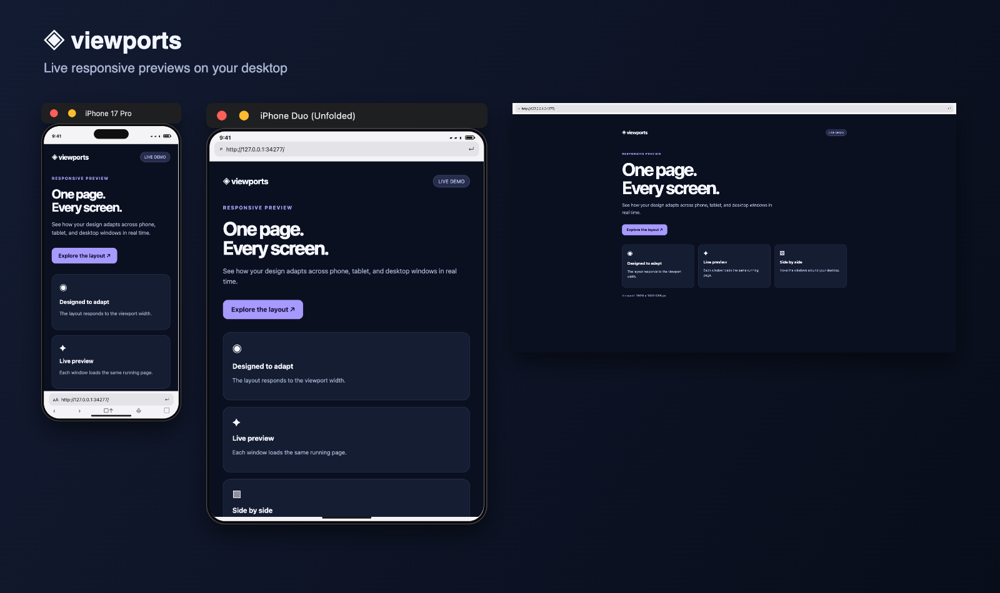

# ◈ viewports

[](https://www.npmjs.com/package/@kubilaycakmak/viewports)

Contributing: see [CONTRIBUTING.md](CONTRIBUTING.md). Maintainers can find the repository map and release checklist in [the handoff](docs/MAINTAINER_HANDOFF.md).

Preview the same website in independent device windows on your desktop. Test responsive layouts across phones, foldables, tablets, laptops, and desktop screens without leaving your development workflow.



## Get started

Start your local development server, then run:

```bash
npx @kubilaycakmak/viewports@latest http://localhost:3000
```

Choose devices, device areas, and text size in the interactive menu. The menu stays open so you can add and remove devices or change settings while you work. You can also use the application menu above the desktop windows.

To select devices directly:

```bash
npx @kubilaycakmak/viewports@latest http://localhost:3000 --devices iphone-17-pro,iphone-duo-unfolded,desktop-hd
```

The first desktop launch downloads Electron. Viewports retries temporary download failures and falls back to Electron's documented mirror; the archive is checked against the checksums bundled with Electron. Custom mirror settings are respected.

## Desktop previews

- Open separate device windows, move them around your desktop, and resize them while preserving their viewport dimensions.
- Add or remove devices from the CLI or the **Devices** application menu.
- Choose whether to display the simulated top and bottom device areas. Desktop previews have a top address bar and no bottom area.
- Enter an address in any visible address bar to navigate all windows in the session.
- Set the browser default text size to **Default**, **Large**, or **Extra Large**. Text explicitly sized in CSS pixels may remain unchanged.
- Use the close and minimize controls above phone and tablet previews. The rounded device frames are illustrative.
- Use the **Screenshot** application menu to save the visible viewport or the full page of an open device as a PNG.

```bash
npx @kubilaycakmak/viewports@latest http://localhost:3000/checkout --devices iphone-17,desktop-hd --text-size large --areas top
npx @kubilaycakmak/viewports@latest --help
```

`--areas` accepts `top,bottom` (the default), `top`, `bottom`, or `none`. Each CLI launch opens a separate session. When the URL is omitted, Viewports tries to detect a running local server from the current project's scripts.

## MCP

Add Viewports to your local MCP client:

```json
{
  "mcpServers": {
    "viewports": {
      "command": "npx",
      "args": ["--yes", "--package=@kubilaycakmak/viewports@latest", "viewports", "mcp"]
    }
  }
}
```

Ask your agent to open a URL on the devices you want. `open_preview` creates the windows and returns a session ID. Use `add_device`, `remove_device`, `list_devices`, `set_device_areas`, `set_text_size`, and `navigate_preview` to manage that session. `capture_screenshot` returns a PNG image for an open device in `viewport` or `full-page` mode. Run the MCP server on the computer where you want the windows to appear. Windows stay open when the MCP connection ends.

On Linux, MCP clients that filter environment variables must pass the desktop session's `DISPLAY` and, when applicable, `XAUTHORITY`, `WAYLAND_DISPLAY`, and `XDG_RUNTIME_DIR` to the server so Electron can connect to the display.

Full-page capture scrolls the main document to trigger lazy loading, then restores its original position. It limits scrolling to 60 steps and images to 16 million pixels and 6 MB; an error is returned when a limit is exceeded. Content that loads slowly, nested scroll containers, animations, and fixed or sticky elements may not appear as expected. Captures include page content, not the simulated device frame. Avoid sharing screenshots containing sensitive information.

## Device presets

The table lists simulated screen sizes in CSS pixels; browser controls reduce the visible page viewport. Foldable open and closed states are separate presets. They do not simulate the hinge, posture APIs, or automatic switching between screens.

iPhone Duo presets use [WebKit's Safari 27.1 portrait viewport measurements](https://webkit.org/blog/18486/webkit-features-for-safari-27-1/): 382 × 580 folded and 669 × 867 unfolded when both device areas are shown. Its unfolded screen dimensions are approximate. Other foldable CSS sizes are estimates; actual values can vary with browser UI and display zoom.

| Category | Device | Width | Height |
|----------|--------|------:|-------:|
| Mobile | iPhone 17 | 402 | 874 |
| Mobile | iPhone Air | 420 | 912 |
| Mobile | iPhone 17 Pro | 402 | 874 |
| Mobile | iPhone 17 Pro Max | 440 | 956 |
| Mobile | Galaxy S26 | 360 | 780 |
| Mobile | Galaxy S26+ | 412 | 915 |
| Mobile | Galaxy S26 Ultra | 412 | 932 |
| Mobile | Pixel 10 | 393 | 851 |
| Mobile | Pixel 10 Pro | 412 | 892 |
| Mobile | iPhone SE | 375 | 667 |
| Mobile | iPhone 14 | 390 | 844 |
| Foldable | iPhone Duo (Folded) | 466 | 678 |
| Foldable | iPhone Duo (Unfolded) | 669 | 951 |
| Foldable | Galaxy Z Fold8 (Folded) | 416 | 657 |
| Foldable | Galaxy Z Fold8 (Unfolded) | 816 | 616 |
| Foldable | Galaxy Z Fold8 Ultra (Folded) | 412 | 960 |
| Foldable | Galaxy Z Fold8 Ultra (Unfolded) | 752 | 835 |
| Foldable | Galaxy Z Flip8 (Unfolded) | 360 | 840 |
| Foldable | Galaxy Z Fold7 (Folded) | 412 | 960 |
| Foldable | Galaxy Z Fold7 (Unfolded) | 750 | 832 |
| Foldable | Pixel 11 Pro Fold (Folded) | 412 | 892 |
| Foldable | Pixel 11 Pro Fold (Unfolded) | 791 | 820 |
| Foldable | Pixel 10 Pro Fold (Folded) | 412 | 901 |
| Foldable | Pixel 10 Pro Fold (Unfolded) | 791 | 820 |
| Tablet | iPad Mini | 768 | 1024 |
| Tablet | iPad Air 11" | 820 | 1180 |
| Tablet | iPad Pro 11" | 834 | 1194 |
| Tablet | iPad Pro 13" | 1024 | 1366 |
| Tablet | Galaxy Tab S10 | 800 | 1280 |
| Laptop | Laptop 1280 | 1280 | 800 |
| Laptop | MacBook 13" | 1280 | 832 |
| Laptop | MacBook 14" | 1512 | 982 |
| Laptop | MacBook 16" | 1728 | 1117 |
| Desktop | Desktop HD | 1920 | 1080 |
| Desktop | Desktop 2K | 2560 | 1440 |
| Desktop | Desktop 4K | 3840 | 2160 |

Previews run in Chromium with a representative user agent and touch emulation. Device frames, browser controls, text scaling, and pixel ratios are approximations; they do not reproduce every hardware or browser behavior. Validate device-specific behavior on real hardware or a platform simulator. On macOS and supported Linux desktops, outer window corners are transparent; Windows retains its native rectangular frame.

## Browser canvas

The original browser canvas remains available:

```bash
npx @kubilaycakmak/viewports@latest web http://localhost:3000
```

Use `--port` to select its server port or `--no-open` to start it without opening a browser. Its transparent proxy removes framing restrictions and forwards WebSocket connections for development. Use the browser canvas only with sites you trust.

## Requirements and troubleshooting

- Node.js **22.12.0 or newer** and a graphical desktop for the desktop app.
- A running development server, or another HTTP(S) URL.

If npm reports `ETARGET` immediately after a new release, its cached package metadata may be stale. Retry with a fresh registry lookup:

```bash
npx --prefer-online @kubilaycakmak/viewports@latest http://localhost:3000
```

To run from a checkout:

```bash
git clone https://github.com/kubilaycakmak/viewports.git
cd viewports
npm ci
npm start -- http://localhost:3000
```

## Changes in v4

Desktop windows are now the default CLI experience. Version 4 adds an interactive menu, MCP server, device frames, text-size settings, and foldable presets. Use the `web` command for the original browser canvas. Version 4 requires Node.js 22.12 or newer.

## License

MIT © 2026 [Kubilay Cakmak](https://github.com/kubilaycakmak).
